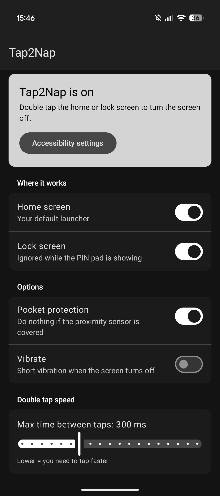
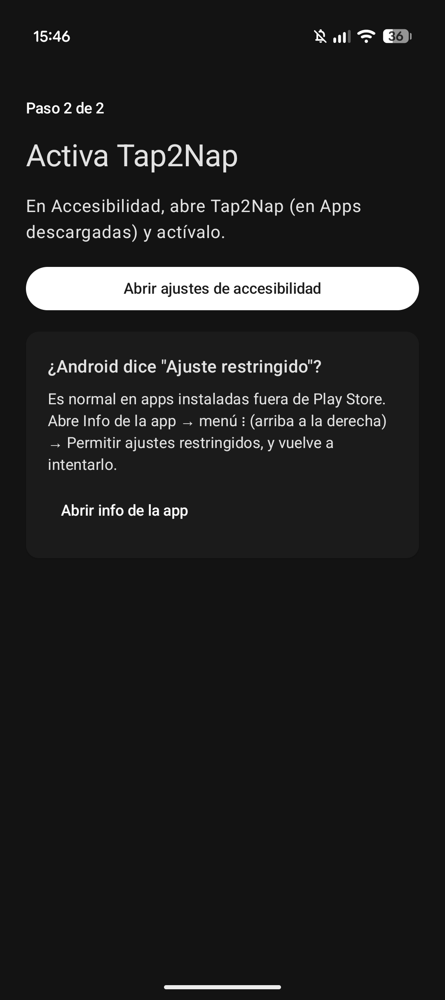
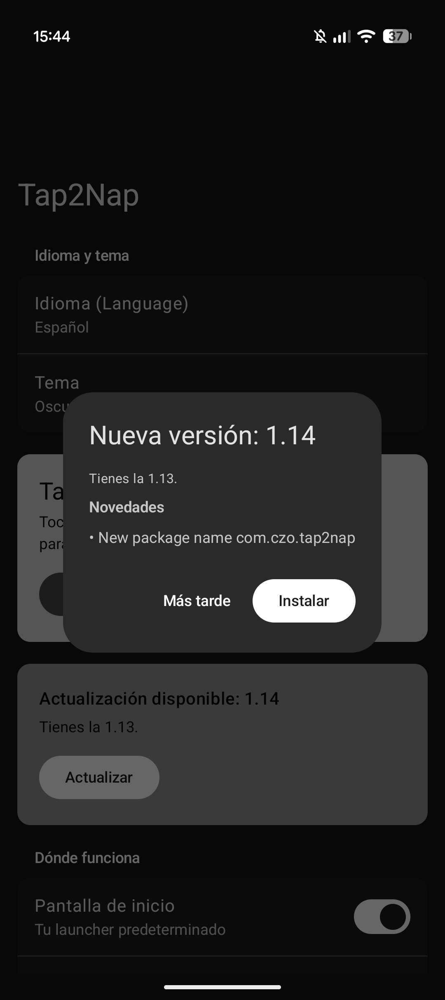

# Tap2Nap

**Double tap to sleep for Android.** Turn the screen off with a double tap on the home
screen and/or the lock screen. Small, open source, no ads, no tracking.

Requires Android 9 or later. English and Spanish.

<!-- Screenshots: save PNGs in docs/screenshots/ with these names -->

  
  
  

## Download
Get the latest APK from [Releases](../../releases/latest). You can also add this repository
to [Obtainium](https://github.com/ImranR98/Obtainium) to get updates automatically.

## Features
- Double tap on the home screen and/or the lock screen to turn the screen off.
- Ignored while the app drawer or the recent apps screen is open, and while the lock
  screen PIN pad is showing.
- **Pocket protection**: does nothing if the proximity sensor is covered.
- Optional vibration with three strengths.
- Adjustable double tap speed.
- **In-app updates**: a popup shows the new version and its changelog, downloads the APK
  and opens Android's update confirmation.
- Guided setup on first launch.
- Material 3 settings with the wallpaper's dynamic colours, themed icon (Android 13+).
- English and Spanish, with an in-app language switch (Android 13+).
- Optional hidden app icon: settings stay reachable from Settings → Apps → Tap2Nap →
  Additional settings in the app, or from Accessibility → Tap2Nap.

## First install
1. Install the APK.
2. Android 10+ only lets an app hide its icon completely if the icon was disabled from
   the start, so **Tap2Nap installs without an icon**. Open Settings → Accessibility →
   Tap2Nap and turn it on: the icon appears in the app drawer.
3. If Android says *Restricted setting*: Settings → Apps → Tap2Nap → ⋮ → *Allow restricted
   settings*, then try again.

## Privacy
Tap2Nap uses Android's Accessibility Service API only to know *when* the screen is tapped
(not where, and never what you type), to check which screen is showing, and to turn the
screen off. It doesn't collect, store or share any data. The only network request is the
update check against this repository's GitHub Releases.

## How it works
- A 1×1 px accessibility overlay with `FLAG_WATCH_OUTSIDE_TOUCH` receives an
  `ACTION_OUTSIDE` event for every touch on the screen without blocking it. Android
  doesn't expose coordinates, only the time of each touch.
- Two touches within N ms (300 ms by default) trigger the following checks:
  - locked and the PIN/password pad is not showing → screen off;
  - unlocked, the active window is the default launcher and neither the app drawer nor
    the recent apps screen is open → screen off.
- If the first tap opens something (a *click* event) or scrolls something (a *scroll*
  event), the double tap is cancelled.
- With pocket protection on, the proximity sensor is read once before turning the
  screen off.
- The screen is turned off with `GLOBAL_ACTION_LOCK_SCREEN`, just like the power button,
  so fingerprint and face unlock keep working.

## Known limitations
- Since there are no coordinates, a double tap on a part of a widget that doesn't react
  to touches will still turn the screen off.
- Lock screen PIN detection relies on common view IDs (AOSP, Pixel, Samsung, Xiaomi…)
  in `BOUNCER_ID_HINTS`.
- App drawer and recent apps detection uses Launcher3 / Pixel Launcher view IDs in
  `LAUNCHER_OVERLAY_IDS`. Other launchers may need their own IDs.

## Building
Open the project in Android Studio, or run `./gradlew assembleRelease` with JDK 17–21.
Pushing a tag like `v1.8` builds the APK on GitHub Actions and publishes a release whose
changelog is made from the commit messages since the previous tag.

## License
[MIT](LICENSE) © 2026 DiegoCZO
